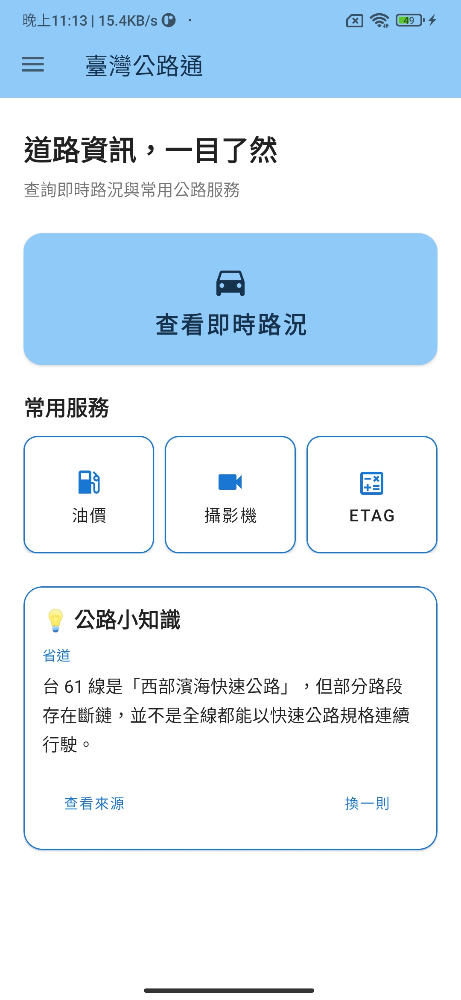
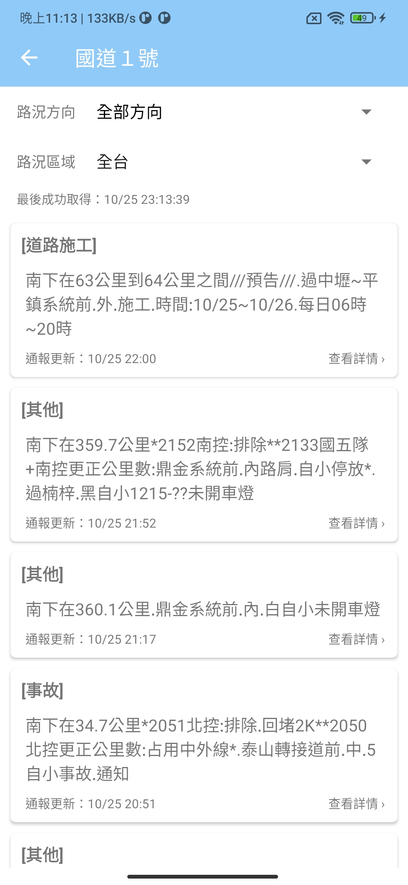
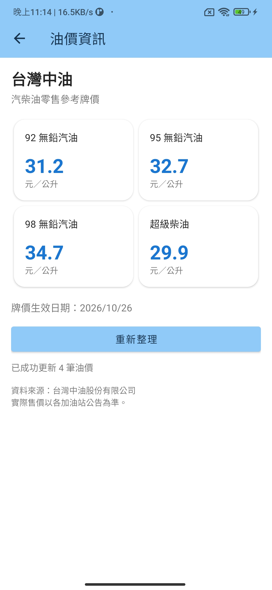
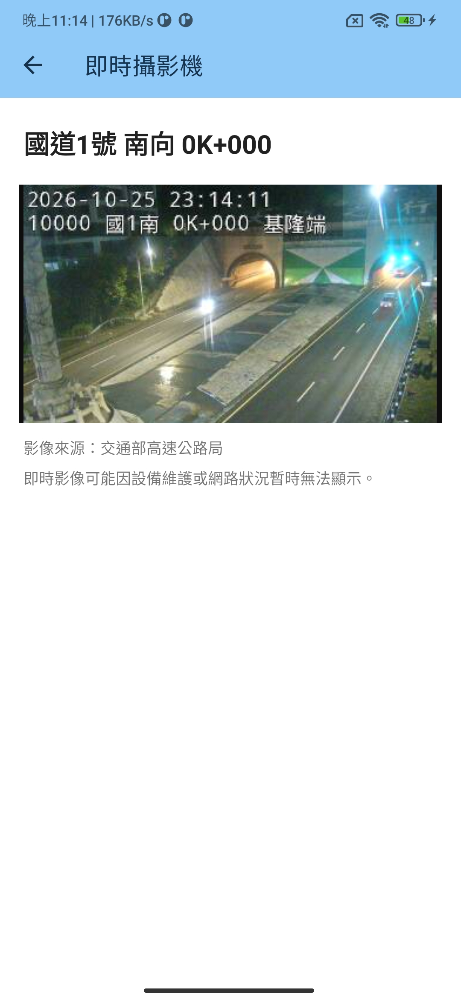
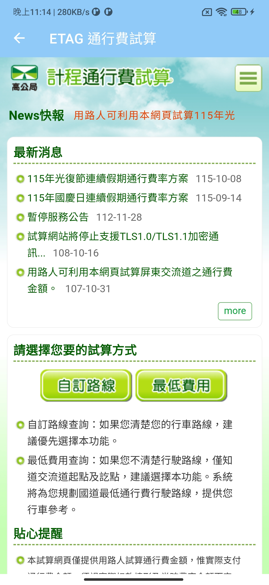

# 臺灣公路通 Taiwan Highway

一款整合臺灣道路交通資訊的 Android 應用程式，提供即時路況、國道攝影機、中油油價與國道通行費試算等功能。

本專案最初為 Android Kotlin 練習作品，於 2026 年重新整理與維護，修復失效的資料來源、改善網路與 JSON 解析流程，並重新設計部分使用者介面，讓舊專案恢復正常運作並具備完整的展示功能。

> **版本：v1.0.0**
>
> 本專案目前以學習、技術實作及 GitHub 作品展示為目的，尚無 Google Play 上架計畫。

## 功能介紹

### 即時道路交通資訊

- 查詢國道、快速公路及一般省道的交通通報
- 依道路、行車方向及地區篩選路況
- 顯示道路施工、交通事故、交通障礙等事件
- 查看事件詳細內容、發生時間與通報更新時間
- 支援下拉重新整理、空資料與網路錯誤狀態

### 國道即時攝影機

- 取得國道 CCTV 攝影機清單
- 依道路、行車方向及里程搜尋攝影機
- 透過 WebView 查看攝影機即時影像
- 顯示攝影機道路、方向及里程資訊

### 中油油價資訊

- 查詢台灣中油公開的汽柴油零售參考牌價
- 顯示 92、95、98 無鉛汽油與超級柴油價格
- 顯示牌價生效日期
- 支援手動重新整理

### 國道通行費試算

- 整合國道通行費試算網站
- 透過 WebView 使用外部試算服務

### 介面與其他功能

- 首頁快速進入常用交通服務
- 支援淺色與深色主題
- 提供離線「公路小知識」及資料來源連結
- 保留經典介面與舊版設計彩蛋
- 使用 SharedPreferences 儲存部分 App 設定

## 應用程式截圖

| 首頁 | 即時路況 |
|---|---|
|  |  |

| 路況詳情 | 油價資訊 |
|---|---|
|  |  |

| 即時攝影機 | 通行費試算 |
|---|---|
|  |  |

| 關於頁面 |
|---|
|  |

## 技術與開發環境

| 項目 | 技術 |
|---|---|
| 開發語言 | Kotlin |
| 平台 | Android |
| UI | XML Layout、ViewBinding、Material Components |
| 網路請求 | OkHttp |
| JSON 解析 | Gson |
| XML 資料解析 | Android XML Parser |
| 清單顯示 | RecyclerView |
| 網頁與攝影機顯示 | WebView |
| 本機設定 | SharedPreferences |
| 建置工具 | Gradle / Android Gradle Plugin |
| 最低 Android 版本 | Android 9（API 28） |
| Target SDK | Android 13（API 33） |

## 專案維護與改進

本次維護主要針對舊專案的相容性、資料取得與使用體驗進行改善。

**資料與網路處理**
- 將失效的警廣路況資料網址更新為可使用的端點
- 配合新版 JSON 結構調整解析流程
- 加入 HTTP 錯誤、空資料及網路異常處理
- 改善路況更新與資料篩選流程

**使用者介面**
- 整理首頁資訊層級與常用功能入口
- 改善路況列表與詳細資訊顯示
- 更新道路標誌與交通事件圖示
- 支援不同主題並保留原始介面特色

**功能擴充**
- 整合中油公開油價資料
- 加入國道 CCTV 清單查詢與播放
- 加入離線公路小知識
- 保留早期版本作為經典模式

## 資料來源與第三方服務

本專案使用以下公開資料與第三方服務：

| 功能 | 資料來源 |
|---|---|
| 道路交通通報 | 警察廣播電臺（警廣）道路交通資料 |
| 國道 CCTV | 交通部高速公路局 |
| 汽柴油牌價 | 台灣中油股份有限公司 |
| 國道通行費試算 | 國道通行費試算網站 |

部分功能需連接外部網站或服務，資料的正確性、更新頻率及可用性取決於原始提供單位。

本專案非上述機關或公司的官方應用程式，亦不代表其認可或背書。

道路標誌及其他第三方素材的來源與授權說明，請參閱 [ASSET_CREDITS.md](ASSET_CREDITS.md)。

## 執行方式

1. 使用 Android Studio 開啟專案。
2. 等待 Gradle Sync 完成。
3. 使用 Android 9（API 28）以上的模擬器或實體裝置。
4. 建置並執行 `app` 模組。

部分功能需要網路連線，且依賴外部資料服務正常運作。

## 已知限制

- 國道 2甲、3甲目前為預留項目，尚未提供正式查詢功能。
- 部分路況通報保留原始資料格式，可能包含特殊符號或非結構化描述。
- 經典路況模式主要保留早期介面設計，錯誤提示較為簡化。
- CCTV 影像可能因設備維護、網路狀況或來源服務調整而無法顯示。
- 本專案不提供行車導航或即時交通安全保證。

## 專案狀態

**v1.0.0 — GitHub 展示版本**

目前已完成主要功能的修復、整合及介面整理。後續是否新增功能，將依開發需求與可維護性評估。

## 免責聲明

本應用程式僅供交通資訊查詢、學習與技術展示使用。

交通事件、油價及攝影機資訊皆可能存在更新延遲或暫時無法取得的情況。實際行車時，請以現場交通標誌、交通管制措施及官方公告為準。

本專案不隸屬於任何政府機關、交通管理單位或資料服務提供者。